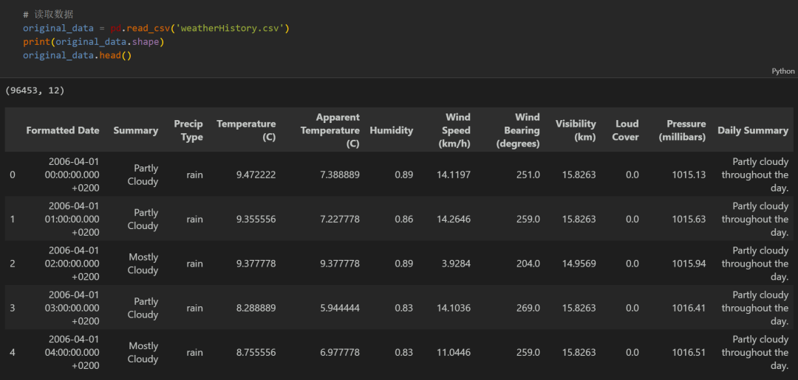
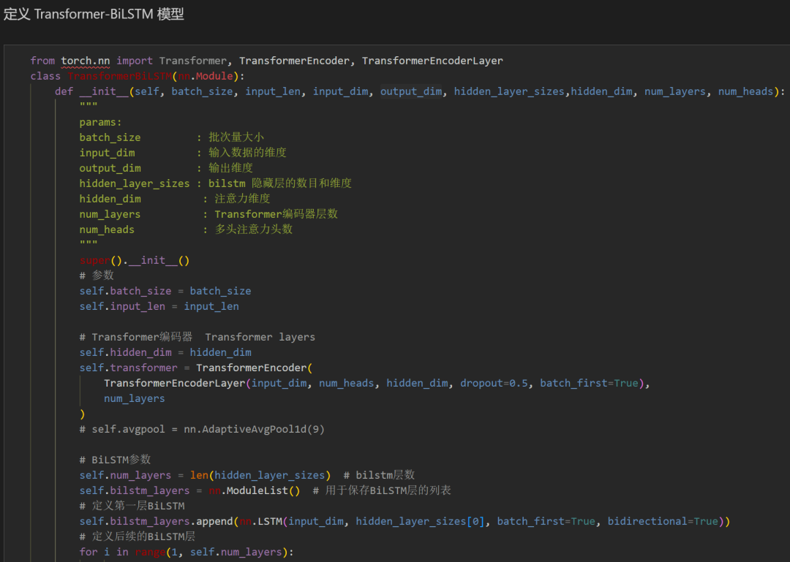
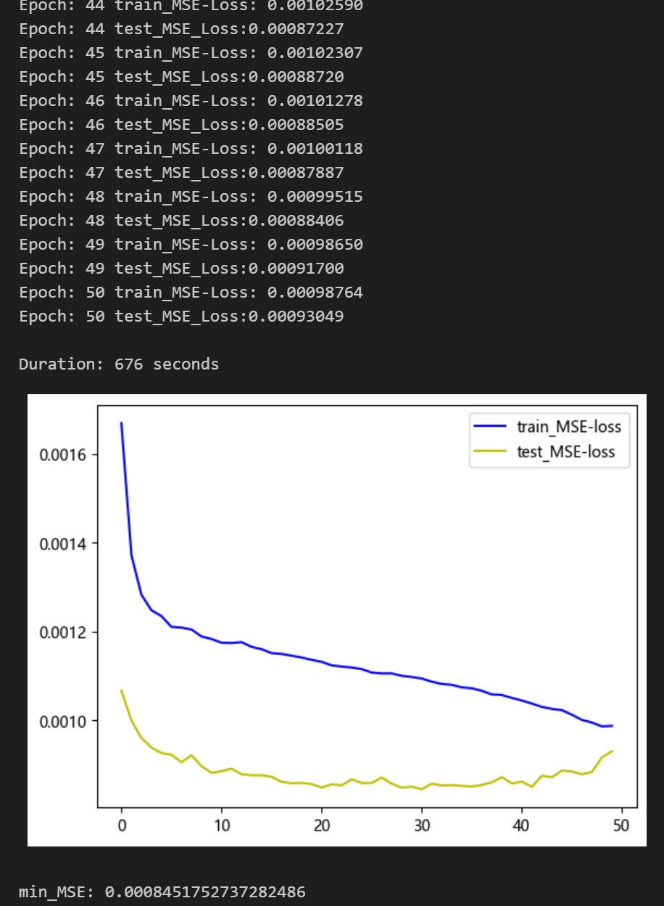
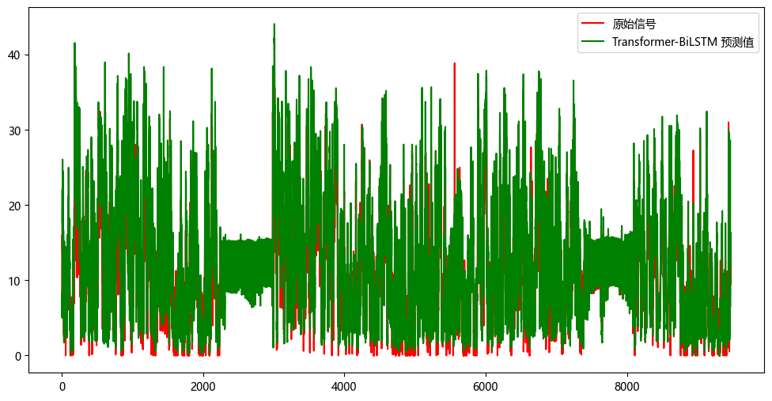
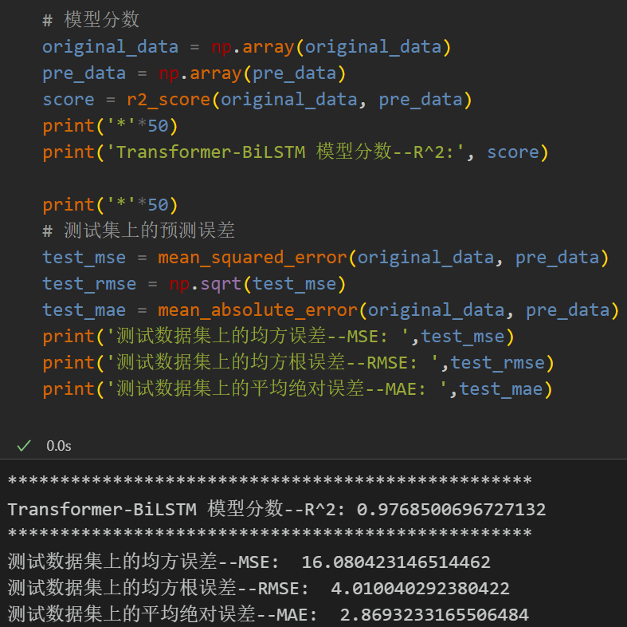
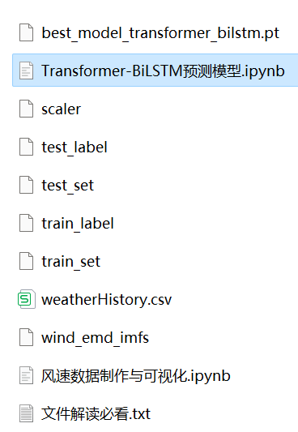
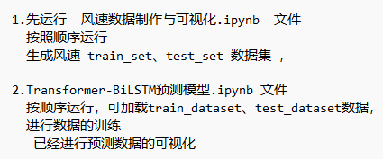

# Multi-feature Variable Sequence Prediction (IV) - Transformer-BiLSTM Wind Speed Prediction Model

Single variable includes the following content:
Including wind speed data, as well as the already generated and prepared wind speed dataset and label set, corresponding codes can be run.
The Transformer-BiLSTM model has smaller MSE and MAE, showing particularly significant results.
Includes code for data preprocessing, and complete Transformer-BiLSTM model prediction and visualization code.
Environment: Python 3.9
Preface
This paper introduces a multi-feature variable sequence prediction model, Transformer + BiLSTM, based on the preliminary introduced wind speed data (dataset attached at the end). This model aims to enhance the predictive performance of time series data. The dataset consists of nine variables including weather, temperature, humidity, pressure, and wind speed. By employing a sliding window approach, this study utilizes multiple variables to predict wind speed.
1. Dataset Preparation and Preprocessing for Multi-Feature Variables
1.1 Import data
1.2 Dataset Preparation and Preprocessing
\tFirst, divide the dataset into training set and test set according to a ratio of 9:1.
\t\tCreating the dataset
2. Transformer + BiLSTM Prediction Model Based on Pytorch
\t2.1 Define the Transformer + BiLSTM prediction model
\tNote: The input wind speed data has a shape of [256, 7, 8], batch_size=256. The number 7 represents the sequence length (the values are taken from a sliding window), and the dimension of 8 represents the selected 8 variables.
2.2 Set parameters and train the model
\t50 epochs, MSE is 0.00084517, the multi-variable feature Transformer-BiLSTM prediction effect is good, appropriately adjusting model parameters can further improve the model prediction performance.
\tNote: Adjust parameters.
\tIt is appropriate to increase the number of Transformer layers and the dimensionality of the hidden layer, and fine-tune the learning rate.
Adjust the number of layers and dimensions in the BiLSTM layer to increase more epochs (note to prevent overfitting).
Change the sliding window length (set an appropriate window length).
3 Model Evaluation and Visualization
3.1 Results Visualization
3.2 Model Evaluation
        \n     \n

## Images

<!-- PAYMENT_BLOCK -->

## Get this dataset

- Payment link (Stripe): [Buy now](https://buy.stripe.com/3cs8yP7sY87d0vu9AB)
- Payment QR code: 

<!-- /PAYMENT_BLOCK -->
